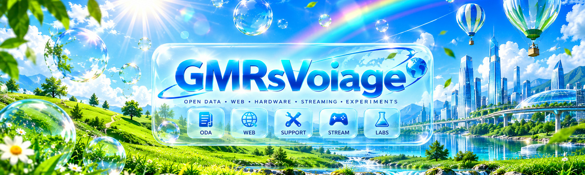
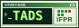
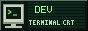
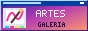
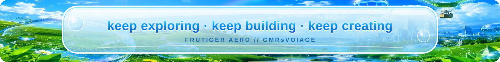

<div align="center">



# 🌊 GMRsVoiage

### `code • open data • web • hardware • streaming • experiments`

<p align="center">
&nbsp;
&nbsp;
&nbsp;

</p>

<!-- Web buttons estáticos em tamanho nativo: links de teclado e foco do próprio GitHub. -->
<p align="center">
<a href="https://gmrsvoiage.com.br"></a>&nbsp;
<a href="https://dev.gmrsvoiage.com.br"></a>&nbsp;
<a href="https://artes.gmrsvoiage.com.br"></a>&nbsp;
<a href="https://twitch.tv/gmrsvoiage"></a>
</p>

</div>

---

## 🌐 Sobre mim / About me

<table>
<tr>
<td width="50%" valign="top">

### 🇧🇷 Português

Olá! Sou **Rafael**, estudante de **Tecnologia em Análise e Desenvolvimento de Sistemas (TADS)** no **IFPR**.

Meu GitHub é um laboratório para transformar curiosidade em projetos de verdade. Atualmente, meus focos são:

- 📰 **Dados públicos:** busca e monitoramento de diários e boletins oficiais.
- 🌐 **Desenvolvimento web:** sites, APIs e serviços que formam o ecossistema GMRsVoiage.
- 🔧 **Hardware e suporte:** manutenção, diagnóstico e ferramentas para assistência técnica.
- 🤖 **Automação e IA local:** experimentos com modelos locais, dados e integrações.
- 🎮 **Streaming e jogos:** interfaces, overlays e experiências inspiradas na internet dos anos 2000.

Gosto de **Frutiger Aero**, interfaces nostálgicas e sistemas que sejam bonitos **e** úteis.

</td>
<td width="50%" valign="top">

### 🇺🇸 English

Hi! I'm **Rafael**, a **Systems Analysis and Development** student at **IFPR**, Brazil.

My GitHub is a digital lab for turning curiosity into working projects. My current focus includes:

- 📰 **Open data:** searching and monitoring official public bulletins.
- 🌐 **Web development:** websites, APIs and the connected GMRsVoiage ecosystem.
- 🔧 **Hardware & support:** PC maintenance, diagnostics and technical-support tools.
- 🤖 **Automation & local AI:** experiments with local models, data and integrations.
- 🎮 **Streaming & games:** interfaces, overlays and 2000s-internet-inspired experiences.

I love **Frutiger Aero**, nostalgic interfaces and building things that look good **and** work well.

</td>
</tr>
</table>

---

## ✨ Em destaque / Featured work

<p>
<a href="https://github.com/GMRsVoiage/edital-monitor"></a>&nbsp;
<a href="https://github.com/GMRsVoiage/oda"></a>&nbsp;
<a href="https://github.com/GMRsVoiage/support-site"></a>&nbsp;
<a href="https://github.com/GMRsVoiage/gmrsvoiage.com.br"></a>&nbsp;
<a href="https://github.com/GMRsVoiage/stream"></a>
</p>

| Projeto | O que estou construindo | Situação |
| :--- | :--- | :--- |
| 📰 **Edital Monitor** | Busca gratuita em publicações oficiais de Telêmaco Borba/PR, usando coleta em Python, Cloudflare Workers, D1 e FTS5. **[Acessar](https://editais.gmrsvoiage.com.br)** | **V1 publicada**, em evolução |
| 🌎 **O Diário Aberto (ODA)** | Evolução da pesquisa em publicações oficiais para múltiplos municípios, com coletores, API, cobertura por cidade e foco em segurança. | **Em desenvolvimento** |
| 🛠️ **GMRsVoiage Support** | Site de assistência técnica, catálogo de serviços e solicitação de orçamento via WhatsApp. A modalidade **Busca & Entrega** está sendo preparada separadamente. **[Acessar](https://suporte.gmrsvoiage.com.br)** | **Site publicado**; expansão planejada |
| 🌐 **Ecossistema GMRsVoiage** | Hub que conecta projetos, portfólios e serviços, com identidade visual AquaWave, modo Frutiger Aero e modo Vaporwave/Synthwave. **[Acessar](https://gmrsvoiage.com.br)** | **Em evolução** |
| 📺 **GMRsVoiage Stream** | Overlays e cenas para OBS. Direção atual: **Nostalgia.exe**, um desktop fictício inspirado na internet clássica, com chat, webcam, transições e alertas. | **Implementação contínua** |

> Os projetos têm estágios diferentes: **site publicado não significa produto finalizado**, e recursos planejados não são apresentados aqui como se já estivessem disponíveis.

---

## 🫧 Meu cantinho da internet / Web ecosystem

Uma rede de experiências conectadas, cada uma com a própria personalidade visual.

<!-- Para adicionar/remover um button, edite um link abaixo e sua linha de descrição. -->
<!-- &nbsp; + espaço permite um intervalo compacto e quebra de linha em telas estreitas. -->
<p>
<a href="https://gmrsvoiage.com.br"></a>&nbsp;
<a href="https://dev.gmrsvoiage.com.br"></a>&nbsp;
<a href="https://artes.gmrsvoiage.com.br"></a>&nbsp;
<a href="https://kah.gmrsvoiage.com.br"></a>&nbsp;
<a href="https://suporte.gmrsvoiage.com.br"></a>&nbsp;
<a href="https://editais.gmrsvoiage.com.br"></a>
</p>

| Endereço | Experiência | Código |
| :--- | :--- | :--- |
| **gmrsvoiage.com.br** | Hub central · Aero durante o dia, Synthwave à noite | [Repositório](https://github.com/GMRsVoiage/gmrsvoiage.com.br) |
| **dev.gmrsvoiage.com.br** | Portfólio técnico em um terminal interativo com monitor CRT | [Repositório](https://github.com/GMRsVoiage/dev) |
| **artes.gmrsvoiage.com.br** | Galeria de artes com visual Aero Glass | [Repositório](https://github.com/GMRsVoiage/portfolio-artes) |
| **kah.gmrsvoiage.com.br** | Portfólio e comissões da Kah, com identidade pastel própria | [Repositório](https://github.com/GMRsVoiage/kah) |
| **suporte.gmrsvoiage.com.br** | Serviços de suporte técnico e contato para orçamento | [Repositório](https://github.com/GMRsVoiage/support-site) |
| **editais.gmrsvoiage.com.br** | Pesquisa em boletins oficiais | [Repositório](https://github.com/GMRsVoiage/edital-monitor) |

---

## 🗂️ Outros projetos / More projects

| Área | Repositório | Descrição |
| :--- | :--- | :--- |
| 🤖 IA local | **[Local Survey Assistant](https://github.com/GMRsVoiage/local-survey-assistant)** | Assistente local com extensão de navegador, Python, MariaDB e Ollama; respostas baseadas em fatos registrados, com verificações sensíveis manuais. |
| 📱 Aplicativos | **[Together Notes](https://github.com/GMRsVoiage/Together-Notes)** | Projeto acadêmico Android para registrar lugares e descobertas. |
| 🎓 Estudos | **[TADS](https://github.com/GMRsVoiage/tads)** | Exercícios, atividades e projetos do curso, organizados por ano e disciplina. |
| 🔌 Hardware / DIY | **[InoHid](https://github.com/GMRsVoiage/inohid)** | Experimentos com entradas físicas, comunicação serial e teclas virtuais. |
| 🎮 Jogos | **[CS2-CFG](https://github.com/GMRsVoiage/CS2-CFG)** | Configurações pessoais de Counter-Strike 2. |
| 🖥️ Ferramentas | **[PS2 OPL SMB Auto-Installer](https://github.com/GMRsVoiage/ps2-opl-smb-autoinstaller)** | Ferramenta portátil para diagnóstico e configuração reversível de compartilhamento SMB para PS2/OPL; **fase inicial**. |
| 🎨 Interface | **[GMRsVoiage RetroWave](https://github.com/GMRsVoiage/gmrs-retrowave)** | Tema Synthwave para phpMyAdmin. |

Também exploro projetos de hardware e games como [DIY-GWheel](https://github.com/GMRsVoiage/DIY-GWheel), [EiLick](https://github.com/GMRsVoiage/EiLick) e [Jogos Digitais](https://github.com/GMRsVoiage/jogosdigitais_rafaelcfragoso).

---

## 🧰 Tecnologias & interesses / Toolbox

| Área | Ferramentas e tecnologias |
| :--- | :--- |
| **Web** | HTML · CSS · JavaScript · TypeScript · Astro |
| **Programação & dados** | Python · Java (estudos) · SQL · SQLite/FTS5 · MariaDB |
| **Cloud & automação** | Cloudflare Pages · Workers · D1 · GitHub Actions · runners self-hosted |
| **IA & integrações** | Ollama · modelos locais · APIs · extensões de navegador |
| **Criação & hardware** | OBS Studio · overlays web · diagnóstico de PCs · projetos DIY |

### 🌱 Explorando a seguir / On my radar

Continuar o desenvolvimento do **ODA**, ampliar o **GMRsVoiage Support**, evoluir a experiência **Nostalgia.exe** nas lives e estudar uma infraestrutura própria com **NAS, Home Assistant e serviços/IA locais**. Essas últimas integrações são objetivos em estudo, não serviços já concluídos.

---

## 💿 Current vibe

```text
╭──────────────────────────────────────────────╮
│  ☁️ glossy skies                             │
│  🌊 blue water                               │
│  🌴 green hills                              │
│  💿 2000s internet optimism                  │
│  🧪 always experimenting                     │
╰──────────────────────────────────────────────╯
```

<div align="center">

*Keep exploring · keep building · keep creating.*



</div>

